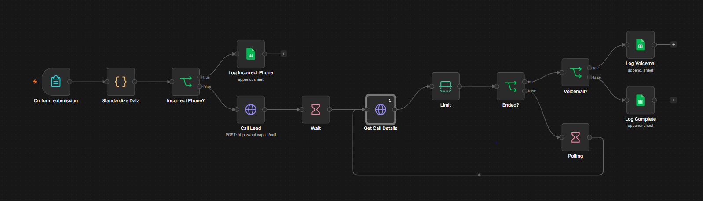

# Vapi Outbound Lead Qualifier Caller Agent

An n8n workflow that places an outbound phone call to every web form lead using a Vapi AI voice agent. It logs the call outcome and the lead's qualification answers to Google Sheets.

## Overview

Leads submit an n8n form with their contact and company details. The workflow cleans the phone number, asks the Vapi API to call the lead, and checks the call until it ends. It then appends a row to Google Sheets with one of three outcomes: incorrect phone number, voicemail, or completed call.

## Workflows

| Workflow | Trigger | Purpose |
| --- | --- | --- |
| Vapi Outbound Lead Qualifier Caller Agent | n8n form submission | Calls each form lead with a Vapi voice agent and logs the outcome to Google Sheets. |

## Workflow Details

### Vapi Outbound Lead Qualifier Caller Agent

This workflow calls a new lead through Vapi and records the result in Google Sheets.

Trigger: an n8n Form Trigger node starts the workflow when a lead submits the form. The form has required fields for name, phone number, email, company name, role, request, and company size. Company size is a dropdown with the options 1, 2-10, 11-50, 51-100, and 101+.

Execution steps:

1. The Form Trigger node receives the submission.
2. A Code node runs JavaScript that removes non-digit characters from the phone number. It keeps a 10-digit number as is, drops the leading 1 from an 11-digit number, and marks any other format as incorrect.
3. An IF node checks whether the phone number is marked incorrect.
4. For a valid number, an HTTP Request node posts to the Vapi API to start a call with the US country code added. It passes the lead's name, company name, and request to the Vapi assistant as variables.
5. A Wait node pauses for 60 seconds.
6. A second HTTP Request node retrieves the call details from the Vapi API.
7. A Limit node passes a single item to the next node.
8. An IF node checks whether the call status is ended.
9. Once the call has ended, an IF node checks whether the end reason is voicemail.
10. A Google Sheets node appends a row that records the outcome.

Branching and loop logic:

- Incorrect phone number: a Google Sheets node appends the lead's form data with the status Incorrect Phone #, and the workflow ends.
- Call not ended: a Wait node pauses for 10 seconds and the workflow returns to the call details request. The loop repeats until the call has ended.
- Voicemail: a Google Sheets node appends the form data with the status Call Back. The Service Interest, Motivation, Urgency, Past Experience, Budget, and Intent? columns hold N/A.
- Completed call: a Google Sheets node appends the form data with the status Complete. It fills Service Interest, Motivation, Urgency, Past Experience, Budget, and Intent? from the structured outputs in the Vapi call record.

Integrations: n8n Form Trigger, Vapi, Google Sheets.

## Integrations

- n8n: Form Trigger, Code, IF, Wait, HTTP Request, Limit, and Google Sheets nodes.
- Vapi: places the outbound call and returns the call details and structured outputs.
- Google Sheets: stores one appended row per lead outcome.

## Prerequisites

- An n8n instance with access to the nodes listed above.
- A Vapi account with a configured assistant and a phone number.
- A Vapi API credential for HTTP Bearer authentication.
- A Google account with a Google Sheets OAuth2 credential.
- A Google Sheets spreadsheet with columns for Date, Name, Phone, Email, Company, Role, Request, Company Size, Service Interest, Motivation, Urgency, Past Experience, Budget, Intent?, and Status.

## Setup

1. Import `Vapi_Outbound_Lead_Qualifier_Caller_Agent.json` from the `workflows` directory into n8n.
2. Create a Google Sheets OAuth2 credential and assign it to the three Google Sheets nodes.
3. Select your spreadsheet and sheet in each Google Sheets node.
4. Create a Vapi API credential with HTTP Bearer authentication and assign it to both HTTP Request nodes.
5. Enter your Vapi assistant and phone number in the JSON body of the call request node.
6. Adjust the 60-second and 10-second wait times if your calls need different timing.
7. Activate the workflow and submit the form to test it.
